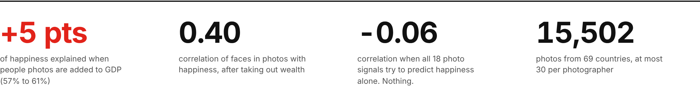
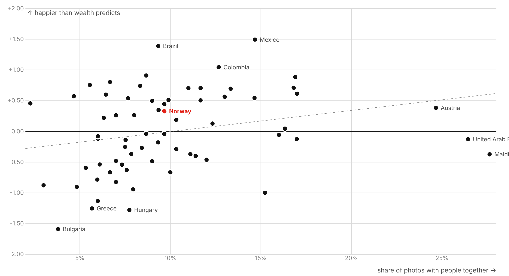
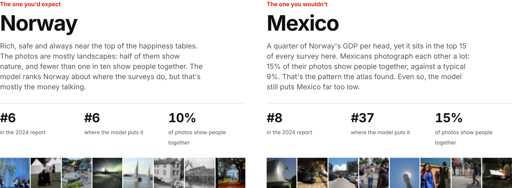
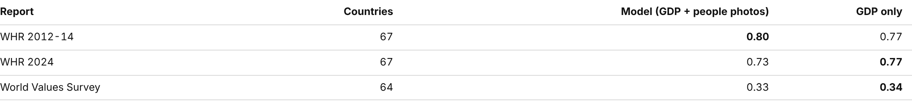
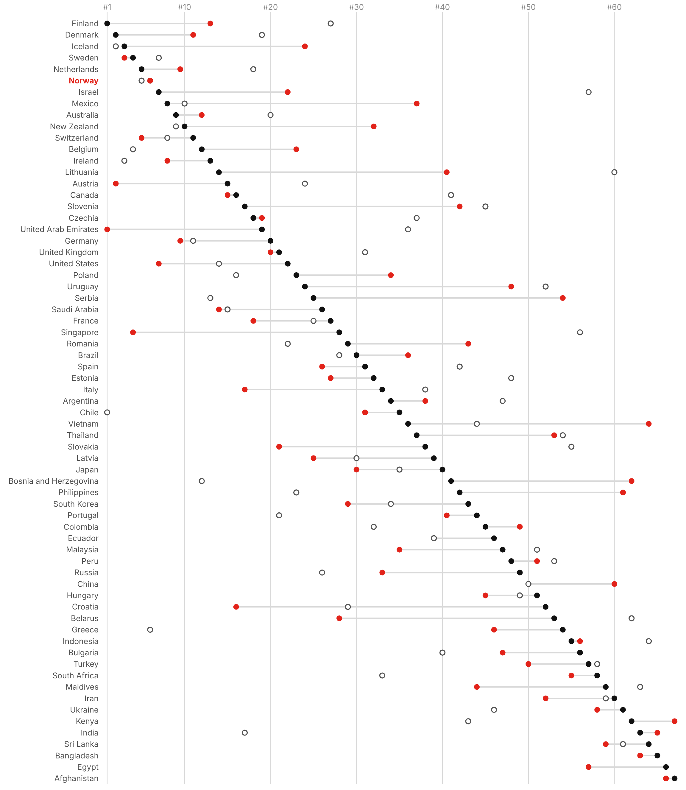
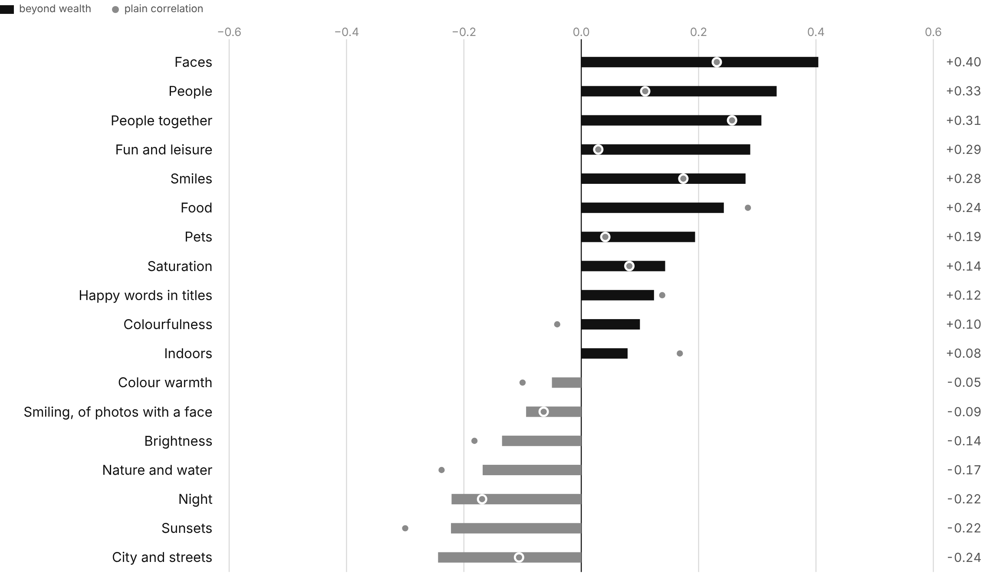

# Atlas of Joy

Do our photos know how happy we are?

I took 15,502 ordinary Flickr photos, each one shot by someone in their own country, across 69 countries. I measured what's in them (faces, smiles, groups of people, nature, colour, the words in the title) and checked all of it against the World Happiness Report.

**Live map:** https://akramvanahmed-projects.github.io/atlas-of-joy/



## Short version

On their own, the photos can't tell a happy country from an unhappy one. All 18 signals together predict happiness no better than shuffled data.

Money is the big confounder, though. GDP per head alone explains 57% of the gap in happiness between countries. Once you take wealth out, one thing shows up clearly: **countries where people photograph other people are happier than their wealth would predict.** Adding three "people" signals to GDP lifts what we can explain from 57% to 61%. In 1,000 placebo runs, a gain that big from random data came up 6 times.

What's interesting is what *doesn't* matter. Whether the people in the photos are smiling barely matters (−0.09). Being in the picture together matters more than looking happy in it.



Mexico, Brazil and Colombia sit at the top: much happier than their GDP suggests. Bulgaria, Hungary and Greece sit at the bottom. The UAE and the Maldives are the outliers on the right. Both have very few local photographers (5 and 6), so I wouldn't read much into them.

## Norway and Mexico



**Norway** is the country you'd expect to see here. It's rich and always near the top: #4 of 67 in the 2012-14 report, #6 in 2024 and #5 in the World Values Survey. Its photos are mostly landscapes. Half show nature, and fewer than one in ten show people together. The model puts Norway at #6, right where the surveys do, but GDP alone would have put it at #2. Norway is happy, and the photos don't really explain why. The money does most of that work.

**Mexico** is the surprise. It has a quarter of Norway's GDP per head, yet it ranks #13, #8 and #10 in the three surveys. 15% of its local photos show people together, against a typical 9%. Of all 69 countries it's the most "happier than its wealth predicts". The photos pull the model in the right direction: GDP alone ranks Mexico #46, and GDP plus people photos ranks it #37. That's still nowhere near the real #8. Whatever makes Mexico happy, a camera only catches part of it.

## Against other reports

The model learned from one report, the World Happiness Report for 2012-14. So I checked its predictions against two things it never saw:

- the same report ten years later (2024)
- the World Values Survey, which simply asks "would you say you are happy?", mostly in its 2017-2022 wave



Rank correlation between each prediction and each report:

| Report | Countries | GDP + people photos | GDP only |
|---|---:|---:|---:|
| WHR 2012-14 | 67 | **0.80** | 0.77 |
| WHR 2024 | 67 | 0.73 | **0.77** |
| World Values Survey | 64 | 0.33 | **0.34** |

The honest reading: the photos help on the data they learned from, but the edge doesn't carry over. On the newer report and on the other survey, GDP alone does as well or slightly better. Two likely reasons. Ten years is a long time: Serbia, Lithuania and Romania each moved more than 20 places. And "are you happy?" is a different question from "rate your life 0 to 10". In this data, GDP tracks the life ratings far more closely (0.77) than it tracks plain happiness (0.34). That's also why both predictions match the World Values Survey so poorly.



Full numbers per country: [`data/processed/compare_countries.csv`](data/processed/compare_countries.csv).

## Signals

Rank correlation with happiness after taking out log GDP per head, 67 countries:

| Signal | Beyond wealth | p |
|---|---:|---:|
| Faces | +0.40 | 0.001 |
| People | +0.33 | 0.006 |
| People together | +0.31 | 0.011 |
| Fun and leisure | +0.29 | 0.018 |
| Smiles | +0.28 | 0.022 |
| Food | +0.24 | 0.048 |
| … | | |
| Night | −0.22 | 0.072 |
| Sunsets | −0.22 | 0.071 |
| City and streets | −0.24 | 0.046 |



Full table: [`data/processed/wealth_check.csv`](data/processed/wealth_check.csv).

## How it works

```
YFCC100M / MediaEval placing set   ->  photo id + country (4.9M photos)
Open Images                        ->  same Flickr photos, image files and labels
   match on Flickr photo id        ->  240k photos
   locals only, caps per person    ->  15,502 photos, 69 countries, 3,112 people
```

1. **Photos.** The MediaEval 2016 placing task gives a country for 4.9M geotagged Flickr photos from YFCC100M. Open Images hosts 9M Flickr photos with labels. Matching the two on Flickr photo id leaves about 240k photos with a country, a photographer and labels.
2. **Locals only.** A photographer's home is the country where at least 60% of their photos were taken (they need 5 or more). Only photos taken at home count, so this measures residents, not tourists.
3. **Fair sampling.** At most 30 photos per person per country and 300 per country, so one keen photographer can't define a country. A country needs 50+ photos from 5+ people to get in.
4. **Signals.**
   - Labels from Open Images. These are machine labels at 50%+ confidence, with human checks overriding them where they exist. They're grouped into smile, face, people, together, fun, nature, sunset, city, indoors, pets, food and night.
   - Colour: brightness, saturation, warmth (red minus blue) and colourfulness, from 9,174 photos that can be downloaded.
   - Title words: whether the title has a happy word in it (party, wedding, holiday, fiesta, Urlaub...).
5. **Happiness.** World Happiness Report 2015 life evaluations (survey years 2012 to 2014), via Our World in Data. That's the same period as the photos.
6. **Tests.**
   - Rank correlation per signal, with bootstrap intervals.
   - Ridge regression on all signals, leave one country out, against 1,000 shuffled runs.
   - Partial correlation after log GDP.
   - GDP-only vs GDP + people signals, leave one country out, against 1,000 runs with the photo signals shuffled between countries.
7. **Other reports.** Both predictions are checked against the WHR 2024 and the World Values Survey "happy" share, by rank correlation.

## Caveats

- **Correlation, not cause.** Photographing friends doesn't make a country happier. More likely, places where social life is visible and valued score higher on both.
- **Flickr isn't everyone.** Users are probably younger, better off and more urban than average, and the gap is likely bigger in poorer countries.
- **Many tests.** I tested 18 signals. With a strict correction (Bonferroni, p < 0.0028) only faces survives on its own. The combined people model survives its placebo test. Treat it as a strong lead.
- **The wealth check came second.** I added it after seeing the first null result. It's the obvious control, but it wasn't planned up front.
- **Old photos.** 2004 to 2014. Phones, Instagram and selfies have changed what people photograph since.
- **Smaller than planned.** I aimed for 300 photos per country. About a third of countries have fewer, and the smallest have 5 or 6 photographers.

## Run it

Python 3.11+.

```
pip install -r requirements.txt
python src/build_index.py    # downloads ~1.3 GB of place data, streams ~3 GB of Open Images ids
python src/sample.py
python src/fetch_labels.py machine
python src/fetch_labels.py human
python src/colour.py
python src/features.py
python src/model.py          # the placebo runs take a few minutes
python src/compare.py
python src/export_site.py
```

You need two raw files first:
- `data/raw/placemeta.sqlite`: [MediaEval 2016 placing metadata](https://multimedia-commons.s3.amazonaws.com/subsets/YLI-GEO/mp16/metadata/placemeta_train_photo.sql)
- `data/raw/boxable_train_ids.txt`: the first column of [Open Images boxable train ids](https://storage.googleapis.com/openimages/2018_04/train/train-images-boxable-with-rotation.csv)

The happiness, survey and GDP files are already in `data/raw`. The site in `docs/` is plain HTML and d3, with no build step:

```
cd docs && python -m http.server
```

## Data and credits

- Photos: Flickr users, via [YFCC100M](https://multimediacommons.wordpress.com/yfcc100m-core-dataset/) and [Open Images](https://storage.googleapis.com/openimages/web/index.html), CC BY 2.0. Each thumbnail on the site links back to the original.
- Happiness: [World Happiness Report](https://worldhappiness.report/) (survey years 2012-14 and 2024) and [World Values Survey](https://www.worldvaluessurvey.org/), both via [Our World in Data](https://ourworldindata.org/happiness-and-life-satisfaction).
- GDP per head (PPP): World Bank via Our World in Data.
- Map shapes: [Natural Earth](https://www.naturalearthdata.com/) via [world-atlas](https://github.com/topojson/world-atlas).

Code is MIT licensed.
